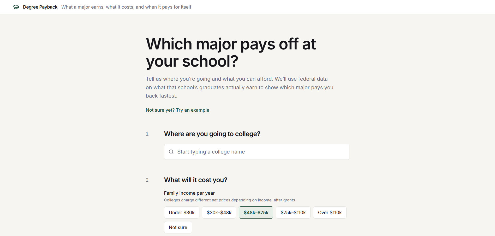
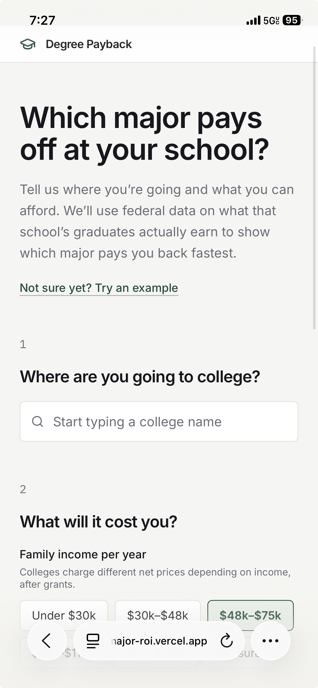
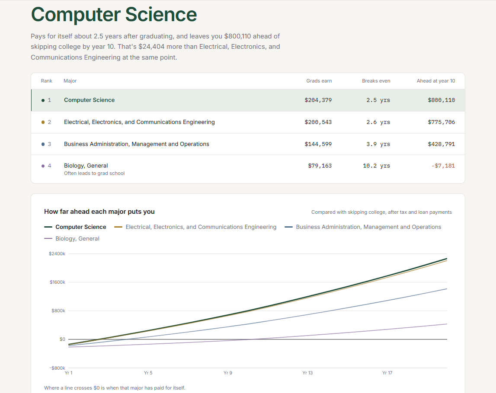
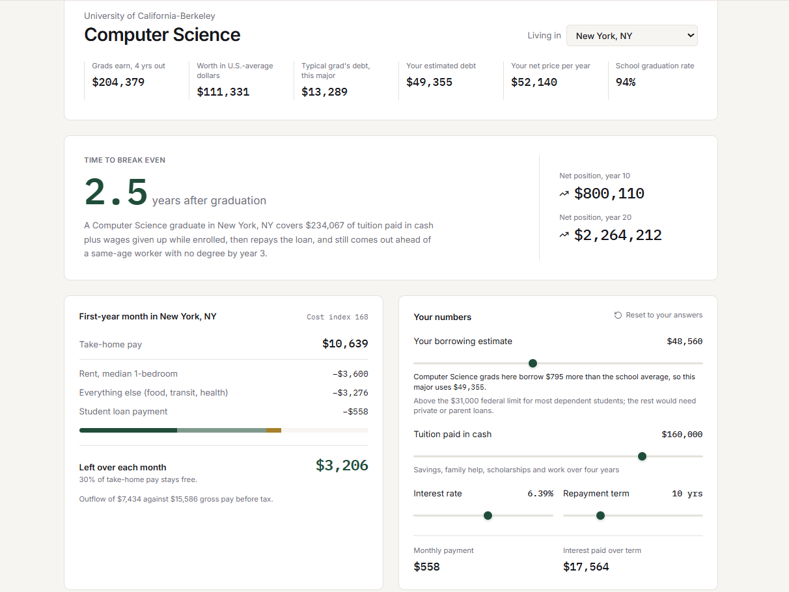

  

<h1 align="center">Degree Payback</h1>

  <strong>What a major earns, what it costs, and when it pays for itself.</strong>

  Make college decisions with financial clarity.

  <a href="https://major-roi.vercel.app/">Launch the Live Application</a>

Degree Payback is a web application that helps students compare the financial outcomes of college majors before choosing a school or degree path. Developed at SASEhack '26, the application brings together information such as starting salary, student debt, and estimated break even timelines to support more informed decisions about higher education.

## The Problem

Choosing a college major can shape someone's finances for years, but information about education costs and career outcomes can be scattered across different sources. Degree Payback aims to make these financial tradeoffs easier to explore in one place.

## Features

- **Side by side comparisons:** Compare up to four majors.
- **Starting salary:** Explore salary information presented by the application.
- **Student debt:** Compare debt estimates.
- **Estimated break even timeline:** Explore how long it may take for a degree's financial benefits to offset its costs, based on the application's estimates.

## Application Preview

### Desktop View: Home Page

### Mobile View: Home Page

### Compare College Majors

### Explore a Graduate's Financial Outlook

## Technology Stack

- **Frontend:** React, TypeScript, Tailwind CSS
- **Application framework and backend:** Next.js, Node.js
- **Government data:** `api.data.gov`
- **Prototyping and AI assisted development:** Magic Patterns and ChatGPT
- **Deployment:** Vercel

## My Contributions

I originated the concept for Degree Payback and collaborated as a four person team at SASEhack '26 to develop it into a working web application during a three day hackathon.

- **Product concept:** Proposed a tool that helps students compare the financial tradeoffs of different college majors using starting salary, student debt, and estimated break even timelines.
- **Government data research:** Researched relevant government data and used ChatGPT to learn how to identify and retrieve data through `api.data.gov`.
- **API research and collaboration:** Shared API related research, findings, and implementation work with my teammates to support the application's data functionality.
- **Technical problem solving:** Explored unfamiliar concepts, evaluated implementation approaches, and worked through development challenges alongside my team.

## Development Workflow

Our team used AI assisted tools throughout development to accelerate prototyping, learn unfamiliar technologies, troubleshoot errors, and connect different parts of the application. We used Magic Patterns to help develop the frontend and ChatGPT to support technical research, implementation, debugging, and integration across the project.

Our workflow involved dividing responsibilities, sharing research and code, and collaborating to bring the frontend, application logic, and government data together. Rather than relying on prior experience with every technology, we learned and iterated as we built.

## Challenges and Lessons Learned

As first time hackathon participants, our team had approximately 55 hours to develop the application, learn unfamiliar tools, coordinate responsibilities, and prepare a project pitch. Working within that time constraint required us to prioritize essential features and keep making progress despite technical obstacles.

Some of our main challenges included:

- **Learning the hackathon process:** Adapting to the pace of a three day event, defining a manageable scope, dividing responsibilities, and balancing development with preparation for our final presentation.
- **Working with government APIs:** Learning how to identify useful public data, structure API requests, understand returned responses, and determine how the data could support comparisons between college majors.
- **Connecting application components:** Coordinating the frontend, application logic, and data retrieval so that information from external sources could be presented through a cohesive user experience.
- **Troubleshooting build and dependency issues:** Working through errors that arose during development and resolving compatibility and configuration problems that affected the application.
- **Integration and deployment:** Bringing individual contributions together, addressing issues that emerged during integration, and using GitHub and Vercel to get the application ready for a live demonstration.
- **Preparing the final pitch:** Explaining the problem, demonstrating the product, and communicating its potential value within the limited hackathon timeframe.

By the end of the hackathon, our four person team had turned an initial idea into a deployed web application. I gained practical exposure to API driven development, rapid prototyping, collaborative software development, and using AI tools to learn and solve problems under real project constraints.

## Future Development

- Expand the selection of college majors available for comparison.
- Allow users to compare more than four majors at a time.
- Gather feedback from students and academic advisors.
- Explore potential partnerships with high school counselors, transfer advising centers, and college access organizations.

## Project Resources

- **Live application:** [Degree Payback](https://major-roi.vercel.app/)
- **Source code:** [My GitHub repository](https://github.com/vanessaobasi/degree-payback)
- **Demonstration video:** [Watch the demonstration](https://youtu.be/7e3n2D9Audo?si=W45Yh2wtAqjrSuoT)
- **Pitch video:** [Watch our product pitch](https://drive.google.com/file/d/1fTarl1T8011jGnfz9JWtQ1O0rRXNIdVz/view?usp=sharing)
- **Presentation slides:** [View the presentation slides](https://drive.google.com/file/d/1i7joCqUH3Zvg7a3sEJVKwQPzHQfHt-Hw/view?usp=sharing)
- **Project story:** [Read the project story](https://drive.google.com/file/d/1LXnRhwWweoR00ai_QR4yt9vAHcu4-PT8/view?usp=sharing)

## Team

Degree Payback was developed by a four person team at SASEhack '26. We shared responsibilities and used AI assisted development tools as we researched data, prototyped the interface, developed application functionality, troubleshot issues, and prepared the deployed project for demonstration.
